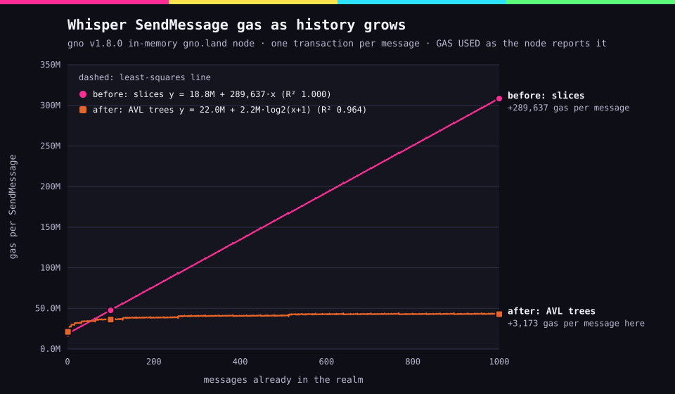

# Gas per SendMessage as history grows



The realm used to keep its history in slices: `messages`, `escrows`, each identity's inbox and sent IDs, and the evidence accumulator's leaves (in `gno.land/p/arobi/assurance`). A slice's backing array is one stored object, loaded and saved again in full on every append. Every send therefore paid for the realm's whole history, and the cost grew without bound.

They are now AVL trees plus counters, and the accumulator is the SDK's `LedgerAccumulator`: the same RFC 6962 tree, its leaves in an AVL tree. An append writes O(log n) small nodes.

## Results

These are real transactions in an in-memory gno.land node: gno v1.8.0 (`fc79041`), one transaction per send, `GAS USED` as the node reports it. One sender (Pro) sends to one recipient, 1,001 times.

| Messages already in the realm | Before (slices) | After (AVL trees) |
|---:|---:|---:|
| 0 | 17,552,793 | 19,953,415 |
| 1 | 18,580,562 | 21,360,523 |
| 10 | 21,384,941 | 29,933,088 |
| 100 | 47,567,560 | 36,468,955 |
| 500 | 163,687,736 | 41,130,621 |
| 1,000 | 308,296,265 | 43,122,198 |

- **Before** is linear: `y = 18,826,445 + 289,637.5·x`, R² 1.000. Residual RMSE is 320,671 gas and the largest residual 1,438,932.
- **After** is logarithmic, not constant: `y = 22,233,651 + 2,200,131.2·log2(x+1)`, R² 0.964. Residual RMSE is 606,998 gas and the largest residual 3,073,259. The steps in the curve are the trees gaining a level.
- From 55 prior messages on, the trees cost less. Below that they cost more, by up to 9.1M gas (at 9 prior messages), because four small trees replace four slices.
- At 1,000 messages a send costs 7.15× less. From 100 to 1,000 messages the old cost grew 6.5× and the new one 1.18×.
- Each script was run twice, and the two runs agree on every send.

The raw per-send gas is in `results/whisper-send-gas-{before,after}.json`: entry `i` is send `i+1`, which saw `i` prior messages.

## Reproduce

1. Get the harness.
   ```sh
   git clone --depth 1 --branch v1.8.0 https://github.com/gnolang/gno
   ```
   gno v1.8.0's testscript harness needs two changes to its own test code for this run. Neither touches gas accounting; gno's `compute_map_key_restore_gas.txtar`, which pins an exact `GAS USED`, still passes after them.
   - `gno.land/pkg/integration/testscript_gnoland.go`: `nodeMaxLifespan` is 120 s. 1,001 sends take about 4 minutes, so raise it (we used 2 h).
   - On Windows only, `loadUserEnv` builds the ABCI path with `filepath.Join`, which gives `auth\accounts\<addr>`, and the node answers "unknown request". Use `path + "/" + addr` (as the same file's other query does).
2. Build: `cd gno/gno.land/pkg/integration && go test -c -o integration.test .`
3. Generate the script from the two repositories. Use `<this repo>` at the commit you want to measure:
   ```sh
   node bench/gas/gen-whisper-txtar.mjs <immaculate-sdk-agent-builder> <this repo> 1001 after <gno>/gno.land/pkg/integration/testdata/whisper_send_gas.txtar
   ```
4. Run. The script ends on a deliberate non-match, so testscript prints every send's `GAS USED`:
   ```sh
   GNOROOT=<gno> ./integration.test -test.run 'TestTestdata/whisper_send_gas$' -test.v > run.log
   ```
5. Read the curve and draw the chart:
   ```sh
   node bench/gas/gas-curve.mjs run.log after.json
   node bench/gas/gas-chart.mjs before.json after.json chart.svg "Whisper SendMessage gas as history grows" message SendMessage
   ```
   The chart fits each series with whichever of `a + b·x` or `a + b·log2(x+1)` has the higher R², and says which.

The scripts measured here:

| File | sha256 |
|---|---|
| `whisper_send_gas.txtar`, before | `433712668c17e20ab2f3d32991abc167a9f9fe1a696d4c815de291e13700cc22` |
| `whisper_send_gas.txtar`, after | `da3c9444c9274a577a23f444fcd80f326f3e8509bb52337aaceb731a76322303` |
